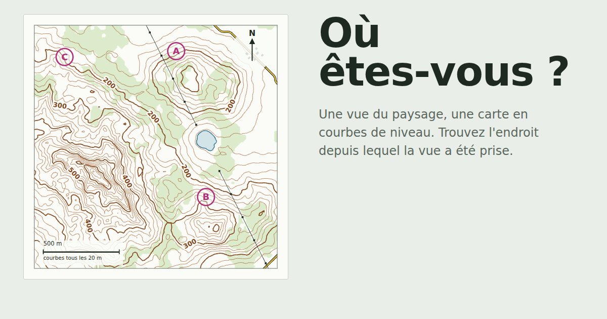

# Où êtes-vous ?

Une vue du paysage, une carte en courbes de niveau, et une seule question : d'où la vue a-t-elle été prise ?



Chaque niveau génère un nouveau relief, sa carte topographique et la vue en 3D depuis l'un des points. Tout tourne dans le navigateur, sans serveur ni compte.

## Ce que propose le jeu

- **Deux façons de répondre** : choisir parmi des points proposés, ou cliquer librement sur la carte avec un score selon la distance.
- **Cinq difficultés** : progressive, facile, normale, difficile et extrême (aucune indication de direction).
- **Cinq reliefs** : collines douces, montagne escarpée, longues crêtes, plateaux, île. On peut aussi les mélanger.
- **Rotation de la carte** : nord en haut, quarts de tour ou angle libre.
- **Éléments de paysage** : forêts, lacs, routes, hameaux et lignes électriques, visibles dans la vue et sur la carte.
- **Conditions de vue** : hauteur d'observation, brume, moment de la journée et saison, réglables ou tirées au hasard.
- **Pression** : chrono par niveau, contre-la-montre ou mort subite.
- **Partage** : un code ou un lien redonne exactement les mêmes terrains et les mêmes réglages.
- **Statistiques détaillées** en fin de partie.

## Mettre le jeu en ligne sur GitHub Pages

1. Sur GitHub, créez un nouveau dépôt **public**, par exemple `ou-etes-vous`. Avec un compte gratuit, GitHub Pages ne publie que les dépôts publics.
2. Déposez tout le contenu de ce dossier à la racine du dépôt. Le plus simple est d'utiliser **Add file → Upload files** et d'y glisser les fichiers et dossiers. Le fichier `index.html` doit se trouver à la racine, pas dans un sous-dossier.
3. Dans le dépôt, ouvrez **Settings → Pages**. Sous **Build and deployment**, choisissez la source **Deploy from a branch**, puis la branche `main` et le dossier `/ (root)`. Enregistrez.
4. Après une à deux minutes, le jeu est en ligne à l'adresse `https://VOTRE-PSEUDO.github.io/ou-etes-vous/`. Elle s'affiche en haut de la page **Settings → Pages**.

Pour la ligne de commande, depuis ce dossier :

```bash
git init
git add .
git commit -m "Première version du jeu"
git branch -M main
git remote add origin https://github.com/VOTRE-PSEUDO/ou-etes-vous.git
git push -u origin main
```

Chaque nouvel envoi sur `main` met le site à jour automatiquement.

Le fichier vide `.nojekyll` indique à GitHub de servir les fichiers tels quels. Sur l'interface web, les fichiers commençant par un point peuvent être masqués lors du dépôt : ce n'est pas grave, le jeu fonctionne aussi sans lui.

## Aperçu du lien sur les réseaux (facultatif)

Pour qu'une image s'affiche quand le lien est collé sur Discord, WhatsApp ou ailleurs, les réseaux exigent une adresse complète. Dans `index.html`, remplacez :

```html
<meta property="og:image" content="assets/og-image.png">
```

par l'adresse finale, par exemple :

```html
<meta property="og:image" content="https://VOTRE-PSEUDO.github.io/ou-etes-vous/assets/og-image.png">
```

## Partager une partie

- Sur l'accueil ou en fin de partie, **Copier le lien** donne une adresse du type `…/ou-etes-vous/?code=22NTA-XNJ3M-2Z0ME`. Ouverte par un ami, elle charge directement la partie avec la même graine et les mêmes réglages.
- **Copier le code** donne seulement le code de 15 caractères, à coller dans le champ « Graine et réglages » de l'accueil.
- Les anciens codes de 11 caractères restent acceptés.

## Tester sur son ordinateur

Ouvrez simplement `index.html` dans un navigateur : le jeu fonctionne sans installation.

Pour reproduire exactement les conditions de GitHub Pages, notamment les liens de partage, lancez un petit serveur depuis ce dossier puis ouvrez `http://localhost:8000` :

```bash
python3 -m http.server 8000
```

## Structure du projet

```
index.html              page et balisage
css/style.css           styles, thèmes clair et sombre
js/core.js              génération du relief, des éléments de paysage et des puzzles (sans dépendance au DOM)
js/app.js               carte SVG, vue 3D, déroulé des parties, statistiques et partage
vendor/three.min.js     Three.js r128, copié localement
assets/                 icône et image d'aperçu
```

`js/core.js` ne touche pas à la page : on peut le charger dans Node pour tester la génération des niveaux.

## Crédits

- [Three.js](https://threejs.org) r128, sous licence MIT (voir `vendor/THREE-LICENSE.txt`).
- Police [Archivo](https://fonts.google.com/specimen/Archivo), chargée depuis Google Fonts, sous licence SIL Open Font License.
